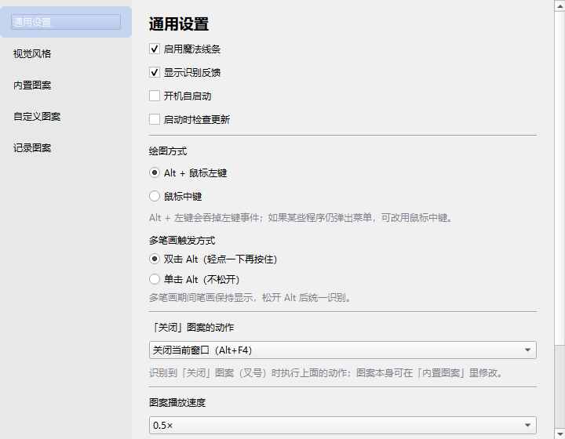

<p align="center">
  
</p>

<h1 align="center">magicallyEncircle for Windows</h1>

在 Windows 屏幕上用「魔法画笔」画出图案来触发快捷键、圈选复制/截图、切换桌面的托盘小工具。

<p align="center">
  
</p>

- 按住 **Alt + 鼠标左键拖动**，即可在任意界面之上绘制发光的魔法线条
- 也可以切换为 **鼠标中键** 绘制，避免 Alt 与部分程序的菜单快捷键冲突
- 画出特定图案触发对应动作（撤销、复制、切换桌面、关闭窗口……）
- 圈选文本可复制、圈选区域可截图
- 支持多笔画图案（如叉号）、自定义图案与快捷键、图案播放演示、绑定 App

> 托盘常驻、无主窗口；绿色便携、无需辅助功能授权。支持 Windows 10 / 11 x64。

---

## 功能特性

### 魔法绘制

- 每块屏幕一个透明、置顶、点击穿透的覆盖层
- 支持多显示器、负坐标、每显示器 DPI 感知
- 托盘图标使用带橙色描边的高对比度 App 图标，方便在浅色/深色任务栏中识别
- 带辉光、渐变、星尘粒子，松手后淡出
- 视觉风格可切换（白橙 / 白蓝 / 白绿 / 白紫 / 白粉 / 随机）
- 覆盖层默认不会被截图/录屏捕获（Windows 10 2004+ 使用 `WDA_EXCLUDEFROMCAPTURE`；旧系统会在圈选截图前临时隐藏覆盖层）

### 图案识别

- 基于 `$1 Unistroke Recognizer`（单笔）+ 逐笔贪心配对（支持多笔）
- 反向绘制、±10° 旋转容错；只需大致相似即可匹配
- 直线滑动单独按方向判定
- **识别反馈 HUD**（可开关）：在鼠标所在屏幕底部显示匹配结果与候选图案相似度排名
- 内置阈值：内置图案 0.72，自定义图案 0.75

### 内置图案（动作）

| 动作 | 默认触发 | Windows 实际发送 |
|---|---|---|
| 后退 / 前进 | ← / → 滑动 | `Alt+←` / `Alt+→` |
| 任务视图 | ↑ 滑动 | `Win+Tab` |
| 窗口速览 | ↓ 滑动 | `Win+Tab`（Windows 没有完全等价的 App Expose） |
| 撤销 | 图案 `Z` | `Ctrl+Z` |
| 复制 | 图案 `C` | `Ctrl+C` |
| 粘贴 | 图案 `V` | `Ctrl+V` |
| 新建标签页 | 图案 `N` | `Ctrl+T` |
| 锁定屏幕 | 图案 `L` | `LockWorkStation()` |
| 删除 | 内置删除图案 | `Delete` |
| 向左 / 向右切换桌面 | 横线 + 左/右箭头图案 | `Ctrl+Win+←` / `Ctrl+Win+→` |
| 关闭 | 图案 `X`（叉号，可多笔） | 默认 `Alt+F4`，可在设置改为 `Ctrl+W` 或退出程序 |

每个内置图案都可以**重新录制**自己的图案来覆盖默认触发，也可以**恢复默认**；除「关闭」外，内置动作还支持换绑快捷键。

> macOS 的「共享」功能在 Windows 版中暂未实现；「显示桌面」也未列入内置动作，可自行绑定 `Win+D`。系统级动作在 Windows 上基本都可以通过 `SendInput` 或原生 API 直接触发，不需要 macOS 那样的私有框架通道。

### 圈选操作（闭环图案）

- **画一个闭合圈 + 快速松手** → 复制圈内文本
  - 使用 Windows 自带 OCR（`Windows.Media.Ocr`）
  - 中文/英文识别依赖系统已安装的 OCR 语言包；中文 Windows 通常已包含
- **画一个闭合圈 + 按住左键 1 秒** → 截图圈选区域并复制到剪贴板
- 截图前会临时隐藏覆盖层，避免把魔法线条截进图片

### 多笔画图案

像「叉号」这类一笔画不好的图案，可以分多笔绘制，最后合并为一个图案识别：

- **Alt 双击（默认）**：单击 = 单笔（松左键识别）；双击（轻点一下再按住）= 多笔（松 Alt 才识别）
- **Alt 单击**（设置可切换）：按住 Alt 即多笔
- **鼠标中键模式**：每次松手后暂存笔画，停止操作 0.2 / 0.5 / 0.75 秒后统一识别
- 多笔期间笔画保持显示，识别后统一淡出

### 自定义图案

- 可录制、重命名、删除、绑定任意快捷键
- 也可以绑定一个或多个 App（exe / 快捷方式），画图案直接打开
- 播放按钮可**演示该图案的绘制过程**（使用当前视觉风格，速度 0.25× / 0.5× / 0.75×，默认 0.5×）
- 录制入口有两个：
  - 托盘菜单 →「记录新图案」，直接在屏幕任意位置画
  - 设置窗口 →「记录图案」，在窗口画布中画

### 设置窗口

托盘图标 →「设置…」打开。左侧栏目：

- **通用设置**：启用魔法线条、显示识别反馈、开机自启动、启动时检查更新、绘图方式（Alt + 左键 / 鼠标中键）、多笔画模式、中键识别速度、「关闭」图案动作、图案播放速度、导入/导出、作者链接与赞赏码
- **视觉风格**：切换线条外观
- **内置图案**：为每个动作播放 / 录制图案 / 设置快捷键 / 恢复默认
- **自定义图案**：网格卡片（图案预览 + 名称 + 绑定），支持播放、重命名、设置快捷键、绑定 App、清除绑定、删除
- **记录图案**：窗口内画布直接绘制并保存为自定义图案

<p align="center">
  
</p>

<p align="center">
  
</p>

### 导入 / 导出

- 导出自定义图案与内置覆盖为 JSON，可分享给他人
- 导入自动合并（重名自动加序号）
- 导出文件带 `platform` / `coordinateSystem` 字段，可与 macOS 版互相导入
- 跨平台导入时：
  - 保留图案
  - 自动转换 y 轴坐标
  - 忽略不兼容的快捷键 / App 绑定，需要在新平台重新设置

---

## 基本操作

| 操作 | 效果 |
|---|---|
| 按住 `Alt` + 左键拖动 | 绘制一条魔法线条（默认） |
| 按住鼠标中键拖动 | 绘制一条魔法线条（设置中切换后） |
| 松左键 | 单笔模式：立即识别 |
| 双击 `Alt` 再按住画多笔，松 `Alt` | 多笔模式：合并识别 |
| 画闭合圈快速松开 | 复制圈内文本 |
| 画闭合圈按住 1 秒 | 截图圈选区域到剪贴板 |
| 托盘 ✨ 图标 | 打开菜单（设置、样式、记录、导入导出、日志、退出） |

---

## 首次使用

1. 解压 `MagicallyEncircle-portable.zip` 到任意**有写入权限**的目录（不要放在 `Program Files` 里直接运行便携版）
2. 双击 `MagicallyEncircle.exe`
3. 托盘出现带橙色描边的 App 图标（Windows 11 可能把它折叠到任务栏的 `^` 区域），HUD 提示启动成功
4. 按住 `Alt` + 左键在屏幕上画一个 `Z`，应触发撤销
5. 右键托盘图标 →「设置…」调整绘图方式、视觉风格或绑定

> 首次运行可能看到 Windows SmartScreen 提示，因为当前版本**没有代码签名**。选择「更多信息 → 仍要运行」即可。

---

## 权限与系统限制

Windows 版**不需要** macOS 那种「辅助功能」或「屏幕录制」授权。全局钩子和透明覆盖层由程序自行安装。

但 Windows 本身有以下限制：

- 普通权限进程无法向**管理员权限窗口**发送输入，也钩不到 UAC / 锁屏安全桌面。
  - 如果确实需要操作管理员窗口，可以尝试以管理员身份运行本程序。
- 部分全屏独占游戏、反作弊程序或安全软件可能会拦截全局钩子或 `SendInput`。
- 个别程序在松开 `Alt` 时会闪一下菜单栏；遇到这种情况请在「通用设置」切换到鼠标中键。
- OCR 依赖系统语言包；未安装对应语言时，圈选复制会提示未找到文本。

---

## 安装与数据位置

### 绿色便携版（推荐）

从 `dist/MagicallyEncircle-portable.zip` 解压即可运行。压缩包内包含 `portable.flag`，因此配置、日志、图案都会保存在 exe 同目录的 `data/` 下。

### 安装包（可选）

安装 [Inno Setup 6](https://jrsoftware.org/isinfo.php) 后运行：

```powershell
powershell -ExecutionPolicy Bypass -File packaging\build.ps1 -Installer
```

生成 `dist/MagicallyEncircle-Setup.exe`，按当前用户安装到 `%LOCALAPPDATA%\Programs\magicallyEncircle`，不需要管理员权限。

### 数据目录

- 便携版：`<exe 所在目录>\data\`
- 安装版：`%APPDATA%\magicallyEncircle\`
- 可用 `--portable` 强制便携模式，或用环境变量 `MAGICALLY_ENCIRCLE_DATA_DIR` 临时指定目录

主要文件：

| 文件 | 内容 |
|---|---|
| `settings.json` | 通用设置、绘图方式、风格、播放速度等 |
| `gestures.json` | 自定义图案 |
| `builtin_overrides.json` | 内置图案的用户录制覆盖 |
| `builtin_shortcuts.json` | 内置图案换绑的快捷键 |
| `logs/app.log` | 运行日志 |
| `logs/crash.log` | 未捕获异常记录 |

托盘菜单 →「打开日志文件夹」可以直接定位日志目录。

---

## 与 macOS 版的对应关系

| macOS | Windows |
|---|---|
| `Option` + 左键 | `Alt` + 左键 |
| 菜单栏 `NSStatusItem` | 系统托盘 `QSystemTrayIcon` |
| `⌘` 快捷键 | `Ctrl` 快捷键 |
| Mission Control | 任务视图 `Win+Tab` |
| App Expose | 窗口速览 `Win+Tab` |
| 三指/四指切换空间 | `Ctrl+Win+←/→` |
| 锁定屏幕 | `LockWorkStation()` |
| ⌘⌫ 删除 | `Delete` |
| Finder 共享菜单 | 暂未实现 |
| 拖文件到屏幕边缘切换桌面 | 暂未实现 |
| DMG | PyInstaller 目录版 + Inno Setup（可选） |

---

## 与 macOS 版互导图案

导出的 JSON 结构：

```json
{
  "version": 2,
  "platform": "windows",
  "coordinateSystem": "appkit-y-up",
  "gestures": [ ... ],
  "builtInOverrides": { ... }
}
```

- 坐标统一导出为 AppKit 风格（y 向上），Windows 导入时自动翻回屏幕坐标；macOS 端可直接使用
- `platform` 用来判断快捷键/App 绑定是否可用：
  - macOS 导入 Windows 文件：保留图案，清空 Windows 键码/App 路径，提示重新绑定
  - Windows 导入 macOS 文件：保留图案，清空 macOS 键码/Bundle ID，提示重新绑定
- 旧版 macOS 文件没有 `platform` 字段时按 `macos` + `appkit-y-up` 处理
- macOS 端对应改动在 `GesturePackage.swift` 与 `MagicController.importGestures()`

---

## 开发运行

推荐使用项目指定的 Python 3.11：

```powershell
D:\work\env\miniconda\envs\p3.11\python.exe -m pip install -r requirements.txt
D:\work\env\miniconda\envs\p3.11\python.exe run_app.py
```

无控制台运行：

```powershell
D:\work\env\miniconda\envs\p3.11\pythonw.exe run_app.py
```

常用参数：

```powershell
python run_app.py --debug       # 控制台输出日志
python run_app.py --settings    # 启动时直接打开设置窗口
python run_app.py --self-test   # 检查显示器枚举与 Windows OCR 后退出
python run_app.py --portable    # 强制使用 exe 同目录 data/
python run_app.py --autostart   # 开机启动（由注册表 Run 项调用）
```

测试时可用：

```powershell
$env:MAGICALLY_ENCIRCLE_DATA_DIR = "C:\Temp\me-test"
```

---

## 构建与打包

```powershell
# 安装构建依赖
D:\work\env\miniconda\envs\p3.11\python.exe -m pip install -r requirements-build.txt

# 生成目录版 + 便携 zip
powershell -ExecutionPolicy Bypass -File packaging\build.ps1

# 可选：生成安装包（需要 Inno Setup 6）
powershell -ExecutionPolicy Bypass -File packaging\build.ps1 -Installer
```

产物：

- `dist\MagicallyEncircle\MagicallyEncircle.exe`
- `dist\MagicallyEncircle-portable.zip`
- `dist\MagicallyEncircle-Setup.exe`（仅在安装 Inno Setup 后）

说明：

- 使用 `--onedir` 而不是 `--onefile`：启动更快、杀毒软件误报更少，也方便替换图标/资源
- 本项目当前用 conda p3.11 构建。conda 把 `ffi.dll` / `libssl` 等运行库放在 `envs\p3.11\Library\bin`，`packaging/app.spec` 已显式把这些 DLL 打进去
- 未做代码签名；如需分发，建议购买代码签名证书并对 exe/安装包签名
- `assets/app.ico` 由 `assets/icon.png` 生成；`build.ps1` 在缺失时会自动生成

---

## 项目结构

```text
magicallyEncircle-win/
├─ run_app.py                     # PyInstaller 入口
├─ run.bat                        # 开发运行脚本
├─ requirements.txt               # 运行依赖
├─ requirements-build.txt         # 构建依赖
├─ portable.flag                  # 便携模式标记
├─ assets/                        # 图标、设置截图、赞赏码
├─ magically_encircle/
│  ├─ app.py                      # 入口、单实例、托盘、日志
│  ├─ controller.py               # 核心协调器（对应 MagicController.swift）
│  ├─ playback.py                 # 图案回放
│  ├─ config.py                   # 路径、设置、便携模式
│  ├─ constants.py                # Win32 常量、阈值
│  ├─ gesture/
│  │  ├─ geometry.py              # 长度/包围盒/闭环/滑动方向
│  │  ├─ recognizer.py            # $1 + 多笔贪心匹配
│  │  ├─ templates_data.py        # 从 macOS 模板提取的数据
│  │  └─ builtin.py               # 内置动作与 Windows 映射
│  ├─ model/
│  │  └─ gestures.py              # 图案数据模型、JSON 持久化
│  ├─ platform_support/
│  │  ├─ win32.py                 # Win32 ctypes 绑定
│  │  ├─ hooks.py                 # WH_MOUSE_LL / WH_KEYBOARD_LL
│  │  ├─ overlay.py               # 每屏透明覆盖层
│  │  ├─ sender.py                # SendInput、打开 App、锁屏
│  │  ├─ capture.py               # 区域截图
│  │  ├─ ocr.py                   # Windows OCR
│  │  ├─ virtual_desktop.py       # 虚拟桌面检测
│  │  ├─ autostart.py             # HKCU Run
│  │  └─ updates.py               # 版本检查
│  └─ ui/
│     ├─ tray.py                  # 托盘菜单
│     ├─ settings.py              # 设置窗口
│     ├─ canvas.py                # 录制画布
│     ├─ hud.py                   # 识别反馈 HUD
│     └─ theme.py                 # 图标、预览、主题
├─ tests/                         # 识别器 / 导入导出单元测试
├─ tools/                         # 开发与联调脚本
└─ packaging/
   ├─ app.spec                    # PyInstaller 配置
   ├─ build.ps1                  # 一键打包
   └─ installer.iss              # Inno Setup 脚本
```

---

## 测试

```powershell
D:\work\env\miniconda\envs\p3.11\python.exe -m unittest discover -s tests -v
```

覆盖内容：模板自识别、反向绘制、±10° 旋转、多笔叉号、直线滑动、闭环判断、Windows/macOS 导入导出与坐标翻转。

联调脚本：

```powershell
python -m tools.smoke_test       # 启动 UI、覆盖层、托盘，4 秒后退出
python -m tools.draw_test        # 合成输入画 Z，验证识别（dry-run）
python -m tools.multi_test       # 合成输入画两笔叉号，验证多笔识别
python -m tools.key_test         # 验证全局快捷键捕获
python -m tools.package_test     # 验证跨平台导入导出
python -m tools.toggle_test      # 验证反复启停不报错
python -m tools.tray_test        # 验证托盘菜单构建
```

> 联调脚本会临时设置 `MAGICALLY_ENCIRCLE_TEST_INPUT=1` 和 `MAGICALLY_ENCIRCLE_DRY_RUN=1`，不会真的发送快捷键或锁屏。

---

## 已知限制

- **没有代码签名**：首次运行可能出现 SmartScreen 提示；带全局钩子的程序也可能被个别杀毒软件误报
- 普通权限进程无法向管理员权限窗口发送输入，也无法钩到 UAC/锁屏安全桌面
- Alt 键在 Windows 上兼有「激活菜单栏」的语义；个别程序可能在松开 Alt 时闪一下菜单。遇到这种情况可切换为鼠标中键
- 未实现「共享」功能
- 未实现「拖文件到屏幕边缘切换桌面」
- 「窗口速览」映射为 `Win+Tab`，与 macOS App Expose 不完全一致
- 全屏独占游戏可能覆盖不了覆盖层；无边框全屏通常正常
- Windows 11 可能把新的托盘图标放进任务栏的 `^` 折叠区，程序无法强制固定；首次启动会弹出提示，也可以点 `^` 展开后把图标拖到常显区域
- 圈选 OCR 使用系统 Windows OCR；需要安装对应语言包
- Windows 版的更新源（`version-win.json`）尚未发布，因此「启动时检查更新」默认关闭；手动检查会提示无法获取版本信息

---

## 更新

- 当前版本：`1.4.0`
- macOS 版的更新源为仓库根目录的 `version.json`
- Windows 版预留了 `version-win.json` 检查逻辑，但尚未发布对应文件；默认不自动检查

---

## ☕ 支持作者

如果这个项目对你有帮助，欢迎请我喝杯咖啡。也可以直接打开 **设置 → 通用设置 → Buy Me A Coffee Pleeeeeease 🥺** 查看微信/支付宝赞赏码：

<p align="center">
  
  
</p>

macOS 原项目：[Si-jiyuan/magicallyEncircle](https://github.com/Si-jiyuan/magicallyEncircle)

---

## License

MIT License. See [LICENSE](LICENSE).
